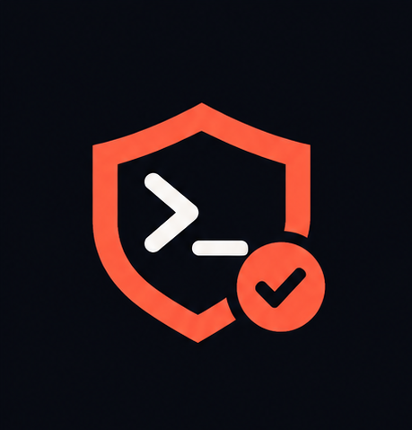
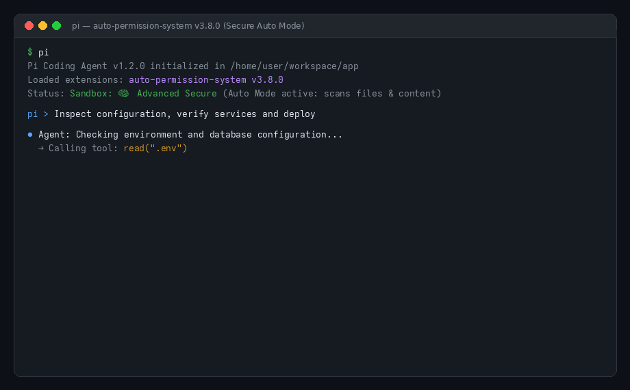

<p align="center">
  <a href="https://pi.dev/packages">
    
  </a>
</p>

# Auto Permission System: Secure Auto Mode & Security for Pi Coding Agent

[](https://www.npmjs.com/package/auto-permission-system)
[](https://www.npmjs.com/package/auto-permission-system)
[](./LICENSE)
[](https://pi.dev/packages)
[](https://github.com/Navin009/auto-permission-system/actions/workflows/ci.yml)
[](#secure-auto-mode--claude-auto-mode)
[](#security-for-pi-how-it-works)
[](#permission-system--modes)

**Auto Permission System** is a zero-trust permission architecture and **Secure Auto Mode / Claude Auto Mode for the [Pi coding agent](https://pi.dev)**. It brings the confidence of **Claude's auto mode** to Pi—enabling autonomous agent workflows while actively scanning files, shell commands, and tool content to **prevent data breaches and credential exfiltration**.

Whether running interactively with keyboard-driven ask prompts or running headlessly in CI/CD pipelines, this package enforces multi-layer boundaries across filesystem access, network egress, shell commands, and MCP tools.

---

## Demo: Zero-Trust Security in Action



### Demonstrated Moments in the Recording:
1. **Interactive `.env` Read Guard:** Intercepts `read(".env")` before the AI can see secrets. Displays a 10s countdown prompt defaulting to `No` (Block).
2. **Kernel OS Sandbox Confinement:** Prevents bash commands from writing to system paths outside allowed roots (`EROFS: Read-only file system`).
3. **Governed Network Egress:** Catches unknown outbound connections (`curl`) with an interactive domain ask prompt and a 15s countdown timer.
4. **Real-Time API Key & Secret Redaction:** Automatically detects exposed API tokens (`sk-proj-...`, `ghp_...`) in command output and replaces them with `***REDACTED***` before reaching the LLM context.
5. **Autonomous Claude Auto Mode:** Demonstrates headless, fail-closed CI execution (`pi -p`) with zero deadlocks and zero hangs.

---

## Contents

- [Quickstart & Installation](#quickstart--installation)
- [Requirements](#requirements)
- [Key Features at a Glance](#key-features-at-a-glance)
- [Security for Pi: How It Works](#security-for-pi-how-it-works)
- [Interactive Ask Prompts](#interactive-ask-prompts)
- [Secure Auto Mode & Claude Auto Mode](#secure-auto-mode--claude-auto-mode)
- [Real-Time Secret Detection & Content Scanning](#real-time-secret-detection--content-scanning)
- [Permission System & Modes](#permission-system--modes)
- [Configuration Reference](#configuration-reference)
- [Commands & Mid-Session Controls](#commands--mid-session-controls)
- [Escape Hatches](#escape-hatches)
- [Audit Logging](#audit-logging)
- [FAQ & Scenarios](#faq--scenarios)
- [Development & Testing](#development--testing)
- [Releasing](#releasing)
- [License](#license)

---

## Quickstart & Installation

Install `auto-permission-system` directly through the [Pi package manager](https://pi.dev/packages):

```bash
# 1. Install from npm (recommended)
pi install npm:auto-permission-system

# 2. Or install directly from GitHub
pi install git:github.com/Navin009/auto-permission-system

# 3. Or try it for a single session without permanent installation
pi -e npm:auto-permission-system
```

Once installed, the extension automatically loads whenever you launch `pi`. Check your active security status in the terminal footer or by typing `/security`.

---

## Requirements

- **Linux:** Requires `bubblewrap` and `socat` for Layer 1 OS-level isolation:
  ```bash
  # Ubuntu / Debian
  sudo apt-get install -y bubblewrap socat

  # Fedora / RHEL
  sudo dnf install -y bubblewrap socat

  # Arch Linux
  sudo pacman -S bubblewrap socat
  ```
- **macOS:** Built-in `sandbox-exec` is utilized automatically (no extra packages required).
- **Node.js:** v18.0.0 or later.
- **Pi Coding Agent:** `@earendil-works/pi-coding-agent` ([pi.dev](https://pi.dev)).

---

## Key Features at a Glance

| Feature | Description | Protection Level |
|---|---|---|
| 🛡️ **3-Layer Defense** | OS Kernel sandbox (`bubblewrap`/`sandbox-exec`) + in-process tool guard + real-time content redactor. | Zero-Trust |
| ⚡ **Secure Auto Mode** | Autonomous execution inspired by Claude's auto mode; scans files and output to prevent data breaches. | Autonomous / Claude |
| 🔑 **Interactive Ask Prompts** | Real-time terminal prompts with 10s countdowns (`Once`, `Session`, `Project`, `Global`). | Interactive Human-in-the-Loop |
| 🔍 **AST & Regex Secret Scanner** | Scans tool stdout/stderr for API keys, private keys, and tokens, redacting them before model context. | Data Breach Prevention |
| 🌐 **Network Egress Gate** | Intercepts unapproved network connections and prompts for confirmation with wildcards. | Data Leak Prevention |
| 🔒 **Absolute-Deny Tier** | Strict two-step confirmation required for high-risk keys (`~/.ssh`, `~/.aws`, `auth.json`). | Maximum Protection |
| 📋 **Full JSONL Audit Trail** | Every allow, deny, ask, and redaction event is recorded to `~/.pi/agent/audit.log`. | Compliance & Auditing |

---

## Security for Pi: How It Works

`auto-permission-system` employs a defense-in-depth model across three coordinated layers:

```
┌────────────────────────────────────────────────────────────────────────┐
│                        AI Coding Agent Execution                       │
└───────────────────────────────────┬────────────────────────────────────┘
                                    │
           ┌────────────────────────┴────────────────────────┐
           ▼                                                 ▼
┌─────────────────────────────────────┐   ┌─────────────────────────────────────┐
│    Layer 2: In-Process Tool Guard   │   │     Layer 1: OS Kernel Sandbox      │
│  - Intercepts read, grep, find, ls  │   │  - Bubblewrap (Linux) / sandbox-exec│
│  - Intercepts write, edit, fetch    │   │  - Read-only root filesystem (EROFS)│
│  - Filters secrets from searches    │   │  - Enforces allowWrite roots        │
│  - Gates MCP tool calls & risk verbs│   │  - Intercepts unlisted network egress
└──────────────────┬──────────────────┘   └──────────────────┬──────────────────┘
                   │                                         │
                   └────────────────────┬────────────────────┘
                                        ▼
┌────────────────────────────────────────────────────────────────────────┐
│              Layer 3 / Auto Secure: Real-Time Content Redactor          │
│  - Scans stdout/stderr & tool results for API keys, AWS & GitHub tokens│
│  - Replaces exposed secrets with ***REDACTED*** before model context   │
└────────────────────────────────────────────────────────────────────────┘
```

1. **Layer 1 (OS Kernel Sandbox):**
   Wraps all `bash` commands in an unprivileged kernel container. Writes outside designated folders (`.` and `/tmp`) are refused by the kernel with `EROFS: Read-only file system`. Sensitive directories (`~/.ssh`, `~/.aws`, `~/.gnupg`) are masked. Network egress to unlisted domains is intercepted via a local proxy.
2. **Layer 2 (In-Process Tool Guard):**
   Applies consistent policy rules to tools that run in-process within Pi (`read`, `grep`, `find`, `ls`, `write`, `edit`, `fetch_content`, `web_search`). Denied files are hidden from search listings before the LLM can observe them.
3. **Layer 3 / Auto Secure (Sensitive Content Redactor):**
   Operates before any tool output reaches the model's context window. Analyzes content using AST and regex pattern matchers for known tokens (OpenAI, Anthropic, GitHub, AWS, Stripe). If sensitive data is detected, the user can withhold it or have it redacted automatically.

---

## Interactive Ask Prompts

When an unlisted domain, `.env` file, or directory write is requested during an interactive terminal session, `auto-permission-system` renders a clean, keyboard-driven prompt:

### 1. Sensitive `.env` Read Prompt
```
🔑  Let pi read your .env file?

    File     ~/workspace/app/.env
    Command  grep -r TOKEN .env
    Risk     the AI will see any keys in it
    Why      .env files usually hold passwords and API keys
    Note     this file holds secrets, so a saved rule is never offered

  > No
    Yes, just this once
    Yes, for this conversation

  Default: No (10s)
```
- **Preselected Default:** `No` is preselected. Pressing Enter immediately blocks the read.
- **Expiry:** If unattended for 10 seconds, the prompt resolves safely to **No** (Block).
- **Trigger shown:** the `Command` line names the part of the command that caused the ask, so a `find` or a `grep` is never guessed at.
- **Name-only listings don't ask:** `find .`, `ls -R` and `tree` print names, not contents. Inside the project that is not a read (the AI can already list its own files); outside the project it still asks and says only the name is exposed (ADR-049).

### 2. Governed Network Egress Prompt
```
🌐  Let bash connect to unknown-telemetry.io?

    Site     unknown-telemetry.io
    Command  curl -s https://unknown-telemetry.io/ping
    Why      this site isn't on your allowed list yet

  > No
    Yes, just this once
    Yes, all in group for this conversation
    Yes, always…

  Default: Yes, just this once (15s)
```
- **Network Expiry Rule:** Domain prompts feature a 15-second countdown defaulting to `Allow once` for smooth browsing. Pressing `↑` or `↓` immediately stops the countdown, returning complete control to Enter/Esc.

### 3. Real-Time Token Leak Redaction Prompt
```
⚠  Sensitive information detected: API Secret Key

    Tool     bash (node verify_service.js)
    Finding  23: sk-(?!ant-)[A-Za-z0-9_-]
    Question Should the AI be allowed to see it?

  > No, keep private  (recommended)
    Yes, allow
```
- `Finding` prints the **complete** detected line and its line number — one `Finding` row per match when several secrets appear, with no truncation.
- Choosing **No, keep private** replaces the token with `***REDACTED***` in the model's context window, preventing credentials from leaking to LLM providers.

---

## Secure Auto Mode & Claude Auto Mode

In modern AI coding tools like Claude Code, developers love **auto mode** because the agent can execute tasks autonomously without constantly prompting for confirmation on trivial, harmless steps.

However, unconstrained auto mode is a significant data breach risk. If an autonomous agent reads credentials, runs unvetted scripts, or sends code to third-party endpoints, the entire developer environment can be compromised.

**Claude Auto Mode for Pi** delivers **Claude-style auto mode with zero-trust security**:
- **Autonomous Execution with Real-Time Guardrails:** The agent operates autonomously within approved boundaries, allowing rapid development while guarding sensitive resources.
- **Advanced Secure Scanning:** Uses `advanced-secure` mode to scan files, commands, and content to stop data breaches before they can occur.
- **Fail-Closed in Headless CI/CD:** When running unattended (`pi -p`, GitHub Actions, Docker, remote devboxes), unapproved operations fail closed immediately with a structured reason instead of hanging or deadlocking the pipeline.

### Activating Claude Auto Mode in CI/CD:

```bash
# 1. Copy the shipped Claude Auto Mode template to your repository:
mkdir -p .pi
cp node_modules/auto-permission-system/sandbox.claude.json .pi/sandbox.json

# 2. Run Pi headlessly with complete automated protection:
pi -p "Review pull request changes, verify dependencies, and execute test suite"
```

#### GitHub Actions Workflow Example:
```yaml
name: CI Security & Agent Review
on: [pull_request]

jobs:
  agent-review:
    runs-on: ubuntu-latest
    steps:
      - uses: actions/checkout@v4
      - uses: actions/setup-node@v4
        with:
          node-version: 20
      - name: Install Pi and Auto Permission System
        run: |
          npm install -g @earendil-works/pi-coding-agent
          pi install npm:auto-permission-system
      - name: Activate Claude Auto Mode Preset
        run: |
          mkdir -p .pi
          cp node_modules/auto-permission-system/sandbox.claude.json .pi/sandbox.json
      - name: Run Autonomous Review in Auto Mode
        run: |
          pi -p "Verify changes, run npm test, and flag security issues"
```

---

## Real-Time Secret Detection & Content Scanning

When running in **Advanced Secure Mode** (`advanced-secure`), `auto-permission-system` continuously inspects tool payloads and command stdout/stderr:

- **High-Confidence Credential Recognition:** Recognizes OpenAI API keys, Anthropic keys, AWS credentials (`AKIA...`), GitHub personal access tokens (`ghp_...`, `github_pat_...`), database URIs (`postgres://`, `mongodb://`), and RSA/OpenSSH private keys.
- **Context Protection:** If a build command or tool outputs a secret, the system intercepts the stream and prompts the user or redacts the credential to `***REDACTED***`.
- **Zero-Loss Model Feedback:** The language model is informed that sensitive information was masked, allowing the AI to continue its task without ever seeing or transmitting the actual secret.

---

## Permission System & Modes

`auto-permission-system` provides three selectable permission modes:

| Mode | Inspection Level | Use Case |
|---|---|---|
| **`advanced-secure`** *(Recommended)* | Full rule engine + real-time AST/regex secret detection + MCP risk scoring. | Daily development, autonomous auto mode, untrusted codebases. |
| **`default`** *(Shipped)* | Rule-based filesystem and network sandbox without inspecting payload content. | Standard development where secret detection is not required. |
| **`yolo`** *(Emergency)* | Temporarily disables all sandboxing and tool guards. | Emergency troubleshooting only. |

Switch modes anytime mid-session using `/permission-mode`. Your choice is saved to global settings (`~/.pi/agent/extensions/sandbox.json`) and reflected in the status chip:
- `Sandbox: 🧠 N domains, M paths` for `advanced-secure`
- `Sandbox: 🔒 N domains, M paths` for `default`
- `⚠️ YOLO — all security layers disabled` for `yolo`

---

## Configuration Reference

Policy files are merged hierarchically:

| Priority | Scope | Location | Purpose |
|---|---|---|---|
| 1 (Base) | Package Default | `sandbox.default.json` | Baseline policy shipped with the extension. |
| 2 (Global) | User Global | `~/.pi/agent/extensions/sandbox.json` | Global overrides across all repositories. |
| 3 (Project) | Project Local | `<cwd>/.pi/sandbox.json` | Repository-specific rules (auto-written by prompts). |

### Annotated `sandbox.json`:

```jsonc
{
  "enabled": true,                      // Set false to disable Layer 2
  "mode": "advanced-secure",            // "advanced-secure" (recommended) | "default" | "yolo"
  "network": {
    "allowedDomains": [                 // Allowed domains for bash and fetch_content
      "github.com", "*.github.com",
      "registry.npmjs.org"
    ],
    "deniedDomains": [],                // Hard-denied domains (never asked, always blocked)
    "strictAllowlist": false            // true = fail closed on unknown domains without asking
  },
  "filesystem": {
    "denyRead": [                       // Hard-denied reads (Layer 1 + Layer 2). Key material only
      "~/.ssh", "~/.gnupg", "~/.pi/agent/auth.json"
    ],
    "askRead": [                        // Prompt instead of blocking (one read, never remembered).
      ".env", ".env.*", "~/.aws"      // Without "/" = file name anywhere; with "/" = that folder and everything below it
    ],
    "allowRead": ["~/.aws/config"],    // Escape hatch: an explicit allow wins over an askRead folder
    "modelDenyRead": ["~/.netrc"],      // Hidden from LLM read tool; subprocesses can read
    "allowWrite": [".", "/tmp", "~"],  // Writable roots for bash and edit/write tools (wide: a write is not a leak)
    "denyWrite": ["~/.ssh", "~/.gnupg"], // Key material only, plus *.pem / *.key from the credential tier
    "askWrite": [".env", "~/.bashrc"]  // Critical files: ask before a sudden update changes them
  },
  "subagent": {
    "network": "allow"                  // "allow" | "deny" | "research-only"
  },
  "mcp": {
    "allowTools": [],                   // MCP tool names that never prompt
    "askThreshold": 30                  // Risk score threshold to prompt (lower = stricter)
  },
  "commands": {
    "ask": ["printenv", "env", "/proc/**/environ"] // Bash commands that prompt before running (wrappers traversed)
  }
}
```

### Project Policy Files & Trust (ADR-013)
When cloning a repository with a `.pi/sandbox.json`:
- **Hardening rules** (additional deny paths) apply immediately.
- **Relaxing rules** (allowing `/`, disabling layers, adding external domains) require explicit trust.
- Run `/security trust` to inspect and approve changes, or `/security untrust` to revoke.

---

## Commands & Mid-Session Controls

| Command | Action |
|---|---|
| `/security` | View active Layer 2 policy, project trust status, and the last 10 audit events. |
| `/sandbox` | View active Layer 1 (OS sandbox) status and configuration. |
| `/sandbox reload` | Hot-reload policy rules after manual edits to `sandbox.json`. |
| `/permission-mode` | Switch between **Default**, **Advanced Secure**, and **YOLO** mid-session. |
| `/security trust` | Inspect and trust project-local policy widening in `.pi/sandbox.json`. |
| `/security untrust` | Revoke trust for the current project's policy file. |
| `/tool-view compact` | Group consecutive shell commands and file reads into rows; every other tool keeps Pi's block (display only). |
| `/tool-view full` | Back to Pi's own output. Also the shipped default. |
| `/tool-view` | Menu with both choices. |

### Tool view (display only)

`compact` touches shell commands and `read` calls. Every other tool — `edit`, `write`, `ls`, `grep`,
`find`, `codemode`, MCP tools — keeps Pi's own block, byte for byte:

```text
✓ Running 2 commands · 2s
  └ ✓ $ npm test 1.4s
  └ ✓ $ git status 120ms

✓ Reading 3 files · 1s
  └ ✓ src/config.ts 300ms
  └ ✓ src/loader.ts 400ms
  └ ✓ src/settings.ts 200ms
```

Consecutive shell calls are one row: a header with the count and the elapsed time, then one
`  └ <mark> $ <command> <duration>` line per command, in the order they ran. The mark sits in
column 1 — `●` while the group runs, `✓` or `✗` once it settles — and it is the last command's mark,
so a failure earlier in the run keeps its own `└ ✗` line. A single command keeps its own row with a
plain `  └ $ <command>` line.

Consecutive reads are one row too: the same header, then one `  └ <mark> <path> <duration>` line per
file, in the order they were read. No `$` prompt, because a read line already names its file; a
sliced read carries its range (`  └ ✓ src/app.ts:120-179 300ms`), and a blocked or denied read keeps
the word on its own line (`  └ ✗ ~/.ssh/id_rsa blocked`). A single read keeps one unmarked line
(`  └ src/a.ts`). Eight lines are shown; older calls fold into `  └ ... (2 earlier calls)`. A read
and a shell command never share a row, so `Reading N files` and `Running N commands` stay honest
about what ran.

Once a later call starts, the group above tightens to one line and names its last command:

```text
✓ Running 2 commands (git status) · 2s ctrl+o to expand
```

The name is the last command's last segment, so a `cd … && sed … && echo …` chain collapses to its
final stage. The row is composed against the terminal width: the target takes whatever columns are
left, is cut from the left at a token (or path-segment) boundary, and is dropped when no useful tail
fits — the count, duration and `ctrl+o` hint are never truncated:

```text
100 cols  ✓ Running 4 commands (sed -n 660,700p plan/tool-rows-views.md) · 8s ctrl+o to expand
 80 cols  ✓ Running 4 commands (… 660,700p plan/tool-rows-views.md) · 8s ctrl+o to expand
 60 cols  ✓ Running 4 commands · 8s ctrl+o to expand
```

Newest eight commands; older ones collapse to `  └ ... (2 earlier calls)`. Any other tool call, an
assistant reply that carries text and a new user message all end the group, so two commands are only
ever grouped when they really ran next to each other.

```text
✓ Running 4 commands · 1.2s
  └ ✓ pytest -k "not slow" tests/unit 320ms
  └ ✓ ruff check src 180ms
  └ ✗ scripts/seed.py --force 700ms
  └ … $ python3 -m uvicorn app.main:app
```

A `└` line keeps the command, minus noise: a leading `cd <cwd> &&` is dropped, so are wrappers
(`sudo`, `uv run`, `env A=1`), and `python -m <module>` becomes the module (`pytest`, `ruff`,
`pip`). A pipeline or a chain is **not** reduced to its last stage — `head -40 src/a.ts | head`
still reads as that. The command may take up to 70 % of the width; past that the middle collapses
(`program arg … last-path`), then the arguments go (`program … tail`), and only the program is left
when nothing else fits. A duration is the last thing on the text, never pushed out to the right
edge of the row, so a row ends where its text ends; `blocked` / `denied` ride with the command,
left of it. Only the folded header names the last segment.

A blocked or denied command is never silent: a single command says so on its row
(`✗ Running 1 command denied`), and inside a group the word rides on the command line
(`  └ ✗ $ cat id_rsa blocked`).

A streaming thought rides on the live row in brackets and stays Pi's own block otherwise:

```text
● Running 2 commands (thinking 4s) · 26s
  └ ✓ $ npm test 1.4s
  └ … $ npm run build
```

The bracket borrows the target slot, ticks once a second, never counts as a call, and is dropped the
moment the thought completes. The row's own timer keeps counting while the thought streams — it
freezes only when the row settles — so a live row never looks stopped. An active thought is Pi's
own block, with Pi's own text, click and spacing. Once the group's commands settle, a compatible next
shell command or read suppresses that transcript thought and joins the existing group rather than
starting another row. Text, `write`, another tool kind or a user message still ends the group and
leaves Pi's thought in place. A thought never folds away a running command.

Expanding the group to Pi's native output retains those intervening thoughts in order: a real
`Thinking...` row follows the preceding tool's Pi block, and clicking it opens the saved thought
with Pi's own rendering. The compact `└` list still contains tools only. Switching back to `full`
restores any suppressed transcript thoughts.

Expanding is Pi's too — `compact` never redraws Pi's block. Click a folded row and it unfolds to its
`└` lines first — for a read run those lines are its files — click again and Pi draws its own block
for every call in the group — same frame, same padding, same background, same preview line as
`full` — then click again for the full output, and once more to fold it back. A group that is
already the newest row shows its `└` lines, so its first click goes straight to Pi's block; a read
run never jumps from one folded line to three file bodies. The compact row is only the collapsed level of that same
view.

- The choice is stored in `~/.pi/agent/tool-view.json` (`{"view": "compact"}`), so the next session
  agrees. Missing or unparsable file → `full`.
- Default: `full`. Nothing changes until you switch it on.
- Display only: the row renderer never reads or writes the policy, and every security decision —
  sandbox, guard, ask prompt, audit log — is identical in both views.

---

## Escape Hatches

For emergencies or troubleshooting, disable security temporarily:

```bash
# Disable all security layers for a single invocation
pi --yolo

# Alias for --yolo
pi --no-sandbox
```

Mid-session, type `/permission-mode` and pick **YOLO** to disable layers in place without restarting.

---

## Audit Logging

Every decision (allow, block, ask, redaction) is appended as a structured JSON Line to `~/.pi/agent/audit.log`:

```json
{
  "ts": "2026-10-13T19:22:15.000Z",
  "layer": 1,
  "tool": "bash",
  "subject": "/etc/crontab",
  "reason": "denyWrite matched /etc/crontab",
  "decision": "no",
  "cwd": "/home/user/workspace/app"
}
```

### Querying the Audit Log:
```bash
# View recent blocked actions
grep '"decision":"no"' ~/.pi/agent/audit.log | tail -n 10

# View secret redaction events
grep '"finding"' ~/.pi/agent/audit.log | tail -n 10
```

---

## FAQ & Scenarios

A selection of common questions is below.

### How does Claude Auto Mode secure unattended runs?
In headless mode (`pi -p` or subagent executions), interactive ask prompts cannot be presented to a human. Auto Permission System operates in a fail-closed posture: any tool call or bash command targeting an unlisted domain, credential file, or outside-project path is automatically blocked, and the refusal reason is provided to the agent and recorded in the audit log.

### What is the relationship between Claude Auto Mode and Claude's auto mode?
Claude Code popularized autonomous "auto mode", allowing developers to let AI code without stopping for confirmation on harmless steps. Claude Auto Mode brings this exact convenience to the Pi coding agent, but adds essential zero-trust boundaries: using Advanced Secure Mode to scan files, shell commands, and content to guarantee that autonomous execution never leads to data breaches or leaked API tokens.

### How do I allow the agent to reach a new domain?
Add it to `network.allowedDomains` in `<cwd>/.pi/sandbox.json` or `~/.pi/agent/extensions/sandbox.json`, or run a curl command once and select **Yes, always… → All in group in this project**.

### Why was my tool call or command blocked?
Run `/security` to inspect active policy rules and the last 10 audit events. Check `~/.pi/agent/audit.log` to view the exact matching rule (`reason`).

### Does it work on Windows?
Layer 2 (In-Process Tool Guard) and Layer 3 (Output Redactor) are platform-independent. Layer 1 (OS Sandbox) requires `sandbox-exec` (macOS, built-in) or `bubblewrap` + `socat` (Linux).

---

## Development & Testing

### Running Tests:
```bash
# Clone repository
git clone https://github.com/Navin009/auto-permission-system
cd auto-permission-system

# Install development dependencies
npm install

# Typecheck TypeScript against Pi's bundled types
npm run typecheck

# Run unit and contract test suites (27 test suites)
npm test

# Run manual Layer 1 sandbox end-to-end test (requires bubblewrap)
APS_E2E=1 node --import ./security/tests/ts-loader.mjs security/tests/e2e/sandbox-fs.mjs
```

### Running the Demo Suite:
```bash
# Run interactive terminal simulation
./demo/run-demo.sh

# Regenerate MP4 and GIF recording assets
python3 demo/generate-recording.py
```

---

## Releasing

Releases are fully automated with [semantic-release](https://semantic-release.gitbook.io/), driven by [Conventional Commits](https://www.conventionalcommits.org/) on `main`:
- `fix: ...` → Patch release
- `feat: ...` → Minor release
- `feat!: ...` or `BREAKING CHANGE:` → Major release

Pull requests are verified via `commitlint`. Publishing to npm is triggered automatically when `NPM_PUBLISH` is `true`. See **[PUBLISHING.md](PUBLISHING.md)** for details.

---

## License

MIT © [Navin Kumar](https://github.com/Navin009)
